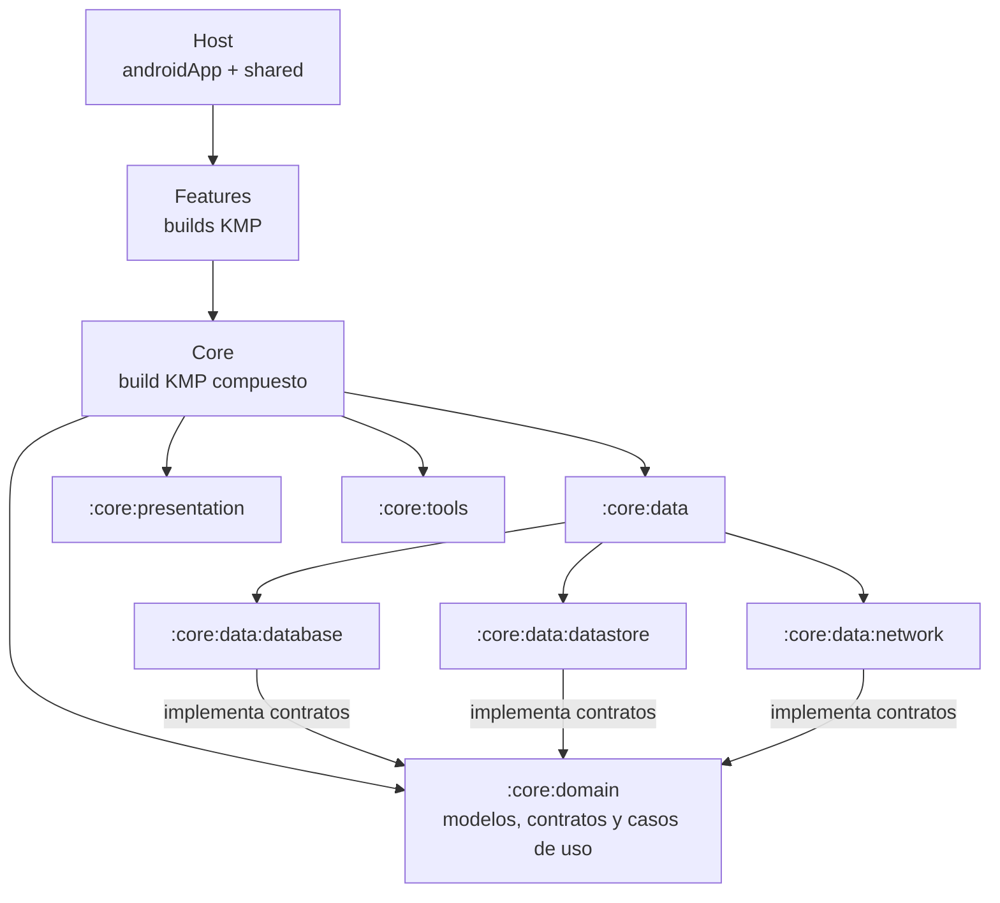

# Core - Kotlin Multiplatform

Core es un build KMP independiente con librerias reutilizables para Android e iOS. Las aplicaciones no deben duplicar estas capacidades: los builds de Features incluyen Core y declaran solo los modulos que necesitan. Core no contiene reglas de una Feature o de una aplicacion concreta.

## Relacion con Host y Features

Los repositorios del workspace se ubican como builds independientes:

```text
MiClaro/
├── androidApp/            # Compone Features para las aplicaciones
├── shared/
├── iosApp/
└── features/
    ├── core/               # Este build: modulos compartidos
    └── <feature>/          # Cada Feature incluye Core como build compuesto
```

Desde la raiz de un Feature, su `settings.gradle.kts` incluye el build local de Core:

```kotlin
includeBuild("../core")
```

`includeBuild` no copia Core dentro del Feature. Gradle resuelve las coordenadas de los modulos contra el build local. Host compone los builds de Features; los Features consumen Core.

### Mapa de dependencias

Host selecciona qué Features componen cada aplicación; cada Feature declara
solo las coordenadas de Core que necesita. Los módulos de datos implementan
contratos definidos en Domain:



## Plataformas y source sets

Los modulos KMP comparten codigo en `commonMain` y separan implementaciones de plataforma en `androidMain` e `iosMain`. El Core configura Android e iOS (`iosArm64` y `iosSimulatorArm64`); los modulos tambien declaran `commonTest` para pruebas compartidas.

```text
core/<module>/src/
├── commonMain/   # API e implementacion compartidas
├── androidMain/  # Integracion Android, cuando se necesita
├── iosMain/      # Integracion iOS, cuando se necesita
└── commonTest/   # Pruebas multiplataforma
```

Los targets iOS requieren toolchain de Kotlin/Native y, para ejecutar o enlazar la aplicacion, macOS y Xcode.

## Modulos del Core

`data` y `presentation` son carpetas agrupadoras, no proyectos Gradle. Los
proyectos son los modulos hoja:

```text
core/
├── domain/                         # :core:domain
│   ├── model/
│   ├── repository/                 # contratos
│   └── usecase/
├── data/
│   ├── network/                    # :core:data:network
│   ├── database/                   # :core:data:database
│   └── datastore/                  # :core:data:datastore
├── presentation/
│   ├── design/                     # :core:presentation:design
│   └── navigation/                 # :core:presentation:navigation
└── tools/                          # :core:tools
```

| Modulo | Responsabilidad y guía |
|---|---|
| [`:core:domain`](core/domain/README.md) | Modelos, contratos de repositorio y casos de uso. Depende de `core:tools` y coroutines; no depende de Data, Presentation ni Koin. |
| [`:core:data:database`](core/data/database/README.md) | Persistencia local con Room KMP: entidades, DAO, data sources, mappers, repositorios y DI. |
| [`:core:data:datastore`](core/data/datastore/README.md) | Preferencias persistentes reactivas y las implementaciones de sus contratos de Domain. |
| [`:core:data:network`](core/data/network/README.md) | Cliente Ktor, DTOs, mappers de transporte, data sources y repositorios remotos. |
| [`:core:presentation:design`](core/presentation/design/README.md) | Tema, colores, tipografía, recursos, modelos de UI y componentes Compose compartidos. |
| [`:core:presentation:navigation`](core/presentation/navigation/README.md) | Contratos de navegación y coordinación de deep links; no implementa pantallas de Features. |
| [`:core:tools`](core/tools/README.md) | Resultados y errores de red, logging, extensiones y utilidades transversales. |

Los modulos se declaran en [`settings.gradle.kts`](settings.gradle.kts); el catalogo de dependencias y versiones esta en [`gradle/libs.versions.toml`](gradle/libs.versions.toml).

### Integraciones destacadas

- **Network:** Ktor usa OkHttp en Android y Darwin en iOS. La configuracion comun incluye serializacion JSON, timeouts, logging y autenticacion Bearer con el token almacenado en DataStore.
- **Database:** Room KMP compila para Android e iOS; KSP genera el codigo de persistencia y el target iOS enlaza SQLite.
- **Design:** los componentes y el tema se comparten desde `commonMain` sobre Compose Multiplatform.
- **Navigation:** Core define contratos; Host proporciona las rutas concretas para evitar que una Feature dependa directamente de otra. `NavigationFeaturesRouter` expone `getWelcomeScreen()`, `getScreenAfterSplash()` y `getDeepLinkScreen(destination)` para resolver la ruta correspondiente sin acoplar una Feature a otra. Para el flujo completo de `hostapp://login`, la recepción Android/iOS y los puentes iOS hacia el coordinador compartido, consulta la [guía detallada de Core Presentation Navigation](core/presentation/navigation/README.md#deep-links-disponibles).

La Feature compartida no debe inspeccionar el flavor ni importar pantallas de otras Features. En el flujo de Splash, puede solicitar una ruta fija a Welcome o emitir una intencion generica de continuar; Host implementa `NavigationFeaturesRouter` en cada flavor/source set y decide el destino. Por ejemplo, si Ecuador no requiere Welcome, su implementacion devuelve Login desde `getScreenAfterSplash()`, mientras CENAM puede devolver Welcome. Mantener esa politica en Host permite que Core y las Features sigan desacoplados.

## Consumir Core desde un Feature

Como Core es un build compuesto, un Feature externo debe usar coordenadas de modulo, no `project(":core:...")`. Declara los alias en el catalogo del Feature:

```toml
[libraries]
core-design = { module = "com.kmp.core:design", version = "unspecified" }
core-network = { module = "com.kmp.core:network", version = "unspecified" }
```

Luego agrega solo las dependencias necesarias en el source set adecuado:

```kotlin
kotlin {
    sourceSets {
        commonMain.dependencies {
            implementation(libs.core.design)
            implementation(libs.core.network)
        }
    }
}
```

Usa `implementation` por defecto. Usa `api` solo cuando los tipos de Core formen parte de la API publica que el Feature expone a sus consumidores. Dentro del propio build de Core, los modulos hoja pueden depender entre si con coordenadas `project`, por ejemplo `project(":core:domain")` o `project(":core:data:network")`.

## Herramientas y versiones

El Gradle Wrapper y el catalogo de versiones son la fuente de verdad:

| Herramienta | Configuracion actual |
|---|---|
| Gradle | Wrapper `9.7.0` |
| JDK toolchain | Java `21` |
| Kotlin | `2.4.20` |
| Android Gradle Plugin | `9.3.3` |
| Android compile / min SDK | `37` / `24` |

Configura Android SDK localmente para compilar Android. No subas archivos de configuracion local, como `local.properties`.
