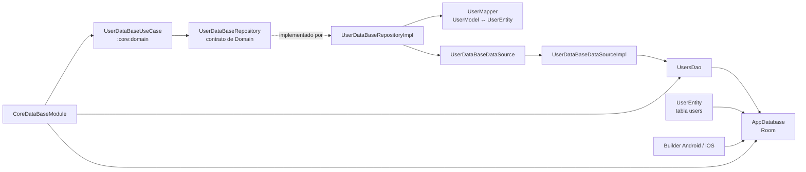

# `:core:data:database` — persistencia local con Room KMP

Este módulo implementa persistencia relacional compartida para Android e iOS.
Room, las consultas, entidades y las capas de acceso viven en `commonMain`;
solo la creación del builder de la base de datos cambia por plataforma.

Si vas a agregar o modificar una operación, sigue el recorrido completo:
**caso de uso → contrato de repositorio → implementación → mapper → data source
→ DAO → Room**. La interfaz que consume Domain no debe exponer tipos de Room.

## Arquitectura y responsabilidades

El ejemplo vigente es la persistencia de usuario. El flujo de llamada y la
creación de la instancia de Room se conectan así:



| Capa | Responsabilidad | Archivo de referencia |
|---|---|---|
| Caso de uso | Expone la operación a la aplicación y prepara el `UserModel`. | `:core:domain` — `usecase/user/UserDataBaseUseCase.kt` |
| Contrato | Define las operaciones con modelos de Domain, sin tipos Room. | `:core:domain` — `repository/user/UserDataBaseRepository.kt` |
| Repositorio | Implementa el contrato, mapea modelos y aplica el dispatcher de IO. | `repository/user/UserDataBaseRepositoryImpl.kt` |
| Mapper | Convierte entre `UserModel` y `UserEntity`. | `mapper/user/UserMapper.kt` |
| Data source | Aísla el repositorio de los detalles del DAO. | `datasource/user/UserDataBaseDataSource.kt` y `UserDataBaseDataSourceImpl.kt` |
| DAO | Declara operaciones y consultas Room para `users`. | `dao/users/UsersDao.kt` |
| Entity / Database | Declara la tabla, sus DAOs y la versión del esquema. | `entity/user/UserEntity.kt`; `config/AppDatabase.kt` |
| DI | Provee la base, el DAO y el caso de uso. | `di/DataBaseModule.kt` |

`UserEntity` representa la tabla `users`, con `id` autogenerado y campos
`email` y `password` anulables. `UserModel` pertenece a Domain. El mapper
actual normaliza los campos anulables al convertir de entidad a modelo.

## Flujo existente: reemplazar el usuario guardado

La firma pública se define en Domain y el módulo de datos la implementa:

```kotlin
// :core:domain
suspend fun clearAndInsertUser(email: String, password: String): Flow<Unit>

// :core:data:database, implementación del contrato
override suspend fun clearAndInsertUser(user: UserModel): Flow<Unit>
```

El caso de uso crea el `UserModel`; el repositorio lo convierte a entidad y
delega en el data source. El DAO ejecuta `clearAndInsertUser` con una
transacción: borra la tabla e inserta el nuevo usuario. El repositorio envuelve
la operación en un `Flow` y aplica el `CoroutineDispatcher` de IO inyectado.

Desde una pantalla o ViewModel, inyecta `UserDataBaseUseCase` y colecciona el
flujo para ejecutar la operación y recibir errores:

```kotlin
viewModelScope.launch {
    userDataBaseUseCase
        .clearAndInsertUser(email = email, password = password)
        .collect { }
}
```

La API actual también ofrece `getFirstUser(): Flow<UserModel?>` y
`deleteUser(user: UserModel): Flow<Unit>`. En cada caso el trabajo ocurre al
coleccionar el flujo.

> **Seguridad:** el flujo actual de Login persiste `UserEntity.password` en
> una base Room ordinaria, sin cifrado configurado. Esto documenta el estado
> existente, no es una recomendación para guardar credenciales. No persistas
> contraseñas en texto plano; para nuevas necesidades, define primero un diseño
> de almacenamiento seguro apropiado.

## Crear la base e inyectar dependencias

`AppDatabase` y `AppDatabaseConstructor` viven en `commonMain`. Room usa
`@ConstructedBy(AppDatabaseConstructor::class)` y el contrato compartido
`expect fun getDatabaseBuilder()`:

| Plataforma | Implementación actual |
|---|---|
| Android | `src/androidMain/kotlin/com/kmp/core/database/AppDatabase.android.kt` obtiene `Context` de Koin y crea la base en `context.getDatabasePath(...)`. |
| iOS | `src/iosMain/kotlin/com/kmp/core/database/AppDatabase.ios.kt` guarda el archivo en `Application Support` y configura `BundledSQLiteDriver`. |

`CoreDataBaseModule` (`di/DataBaseModule.kt`) configura `Dispatchers.IO`,
construye `AppDatabase`, provee `UsersDao` y registra el caso de uso de Domain.
El módulo usa `@ComponentScan("com.kmp.core.database")`; las implementaciones
de repositorio y data source usan `@Factory`. Al añadir bindings, conserva el
patrón explícito de anotaciones y registros actual: Domain no depende de Koin.

## Añadir una operación o entidad

Para una nueva operación sobre una tabla existente, propaga el contrato por
estas capas y conserva los modelos de cada frontera:

1. Declara la operación en el DAO con su consulta Room.
2. Expónla en la interfaz y la implementación del data source.
3. Añádela al contrato de repositorio de Domain con modelos de Domain.
4. Implementa ese contrato en `UserDataBaseRepositoryImpl`, usando el mapper
   cuando cruce entre `UserModel` y `UserEntity`.
5. Expón la operación desde el caso de uso y verifica que Koin registre las
   dependencias necesarias en el módulo de datos.

Si agregas una entidad, inclúyela en `entities` de `AppDatabase`, agrega y
expón su DAO, y registra cualquier binding nuevo que se inyecte por separado.

## Cambios de esquema y verificación

- Al cambiar el esquema, incrementa la versión de `AppDatabase` y proporciona
  una migración para bases ya instaladas. Prueba tanto la migración como el
  comportamiento esperado; no presupongas que los datos pueden recrearse.
- `build.gradle.kts` configura `room3 { schemaDirectory(path = "$projectDir/schemas") }`,
  pero `AppDatabase` declara `exportSchema = false` y este checkout no contiene
  el directorio `schemas`. No asumas que ya hay historial exportado o migraciones
  registradas. Si necesitas ese historial, incorpora también la configuración
  y verificación de exportación.
- Mantén la creación específica de plataforma en `androidMain` e `iosMain`; el
  contrato del builder y el uso de Room permanecen compartidos.
- `build.gradle.kts` compila Android e iOS (`iosArm64` e
  `iosSimulatorArm64`) y configura KSP para Room en esos targets.

Para la visión completa de modelos y contratos, consulta la
[guía de `:core:domain`](../../domain/README.md). La integración de los módulos
Core en builds de Feature está en la [guía principal de Core](../../../README.md).
