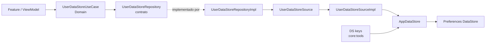

# Core DataStore

Guía rápida para entender y ampliar las preferencias persistentes compartidas de Android e iOS.

## Vista de capas

El contrato de repositorio y el caso de uso pertenecen a Domain; este módulo
implementa el acceso al almacén. La clave compartida se declara en Tools.



## Qué persiste

Este módulo usa **Preferences DataStore** (`DataStore<Preferences>`), un almacén clave-valor. No define modelos ni serializadores propios. Las claves actuales están en `core:tools`, en `DS`:

- `DS.KEY.USER_TOKEN`: `String`; si no existe, `AppDataStore.userToken` emite `null`.
- `DS.KEY.STATUS_USER_CREDENTIALS`: `Boolean`; si no existe, `AppDataStore.statusUserCredentials` emite `false`.

`AppDataStore` expone lecturas como `Flow` y escribe con `dataStore.edit { ... }`. Si la lectura falla con `IOException`, emite preferencias vacías (por eso se aplican los valores por defecto); otros errores se vuelven a lanzar.

## Una instancia compartida en cada plataforma

`createDataStore()` se declara como `expect` en `src/commonMain/.../AppDataStore.kt` y tiene una implementación por plataforma:

- **Android** (`src/androidMain/.../AppDataStore.android.kt`): `PreferenceDataStoreFactory.createWithPath` guarda `kmp_dataStore.preferences_pb` bajo `Context.filesDir`. Obtiene el `Context` de Koin (`getKoin().get()`); la aplicación registra el contexto Android al iniciar Koin.
- **iOS** (`src/iosMain/.../AppDataStore.ios.kt`): usa `NSApplicationSupportDirectory` y el mismo nombre de archivo.

`CoreDataStoreModule` declara el `DataStore` como `@Single` mediante `createDataStore()`. `AppDataStore` también es `@Single`, así que sus consumidores comparten el almacén registrado, en vez de crear instancias independientes. El módulo está anotado con `@Module`, `@Configuration` y `@ComponentScan("com.kmp.core.datastore")`; las implementaciones del data source y repositorio usan `@Factory`.

El contrato `UserDataStoreRepository` y `UserDataStoreUseCase` pertenecen a
`:core:domain`; `:core:data:datastore` contiene sus implementaciones. Como
Domain no depende de Koin, `CoreDataStoreModule` registra explícitamente el
factory del caso de uso.

## Flujo actual: estado de “recordar credenciales”

El recorrido de lectura es:

1. `UserDataStoreUseCase.getStatusUserCredentials()` delega a `UserDataStoreRepository`.
2. `UserDataStoreRepositoryImpl` delega a `UserDataStoreSource` y aplica `flowOn(ioDispatcher)`.
3. `UserDataStoreSourceImpl` lee `AppDataStore.statusUserCredentials`.
4. `AppDataStore` observa `DataStore.data` y mapea la clave a `Boolean`, con `false` como valor inicial.

Para guardar, las mismas capas exponen `saveStatusUserCredentials(status)`. El repositorio convierte la escritura suspendible de la fuente en `Flow<Unit>`; por tanto, la escritura ocurre al **coleccionar** ese flujo. El token sigue el mismo patrón: `getUserToken()` y `saveUserToken(token)`.

Como ejemplo de consumidor, `LoginViewModel` recoge el estado al inicializarse. Si es `true`, obtiene el primer usuario mediante `UserDataBaseUseCase`; al marcar o desmarcar la opción, recoge el flujo devuelto por `saveStatusUserCredentials`. El estado booleano está en DataStore; las credenciales que consulta ese flujo viven en la base de datos, no en esta preferencia.

## Ejemplo de extensión: preferencia de tema

Un tema visual es un dato no secreto adecuado para preferencias. El siguiente es un **ejemplo de cambios que habría que implementar**, no una API que ya exista. Conserva el flujo actual: clave → `AppDataStore` → fuente → repositorio → caso de uso.

1. En `core:tools/.../DS.kt`, reutiliza el import existente de `stringPreferencesKey` y agrega:

   ```kotlin
   val THEME = stringPreferencesKey("theme")
   ```

   dentro de `DS.KEY`.

2. En `AppDataStore.kt`, agrega una lectura y una escritura con las APIs de Preferences DataStore ya usadas en el archivo:

   ```kotlin
   val theme: Flow<String?> = dataStore.data
       .catch { exception ->
           if (exception is IOException) emit(emptyPreferences()) else throw exception
       }
       .map { preferences -> preferences[DS.KEY.THEME] }

   suspend fun saveTheme(theme: String) {
       dataStore.edit { preferences -> preferences[DS.KEY.THEME] = theme }
   }
   ```

   Reutiliza el import existente de `stringPreferencesKey` en `DS.kt` y los imports ya presentes en `AppDataStore.kt`.

3. Propaga las operaciones existentes por las capas compartidas:

   ```kotlin
   // UserDataStoreSource
   suspend fun getTheme(): Flow<String?>
   suspend fun saveTheme(theme: String)

   // UserDataStoreSourceImpl
   override suspend fun getTheme(): Flow<String?> = dataStore.theme
   override suspend fun saveTheme(theme: String) = dataStore.saveTheme(theme)

   // UserDataStoreRepository
   suspend fun getTheme(): Flow<String?>
   suspend fun saveTheme(theme: String): Flow<Unit>

   // UserDataStoreRepositoryImpl
   override suspend fun getTheme(): Flow<String?> =
       usersDataStoreSource.getTheme().flowOn(context = ioDispatcher)

   override suspend fun saveTheme(theme: String): Flow<Unit> = flow {
       emit(value = usersDataStoreSource.saveTheme(theme = theme))
   }.flowOn(context = ioDispatcher)

   // UserDataStoreUseCase
   suspend fun getTheme(): Flow<String?> = repository.getTheme()
   suspend fun saveTheme(theme: String): Flow<Unit> =
       repository.saveTheme(theme = theme)
   ```

   Coloca cada declaración dentro de su tipo correspondiente; los imports de `Flow`, `flow` y `flowOn` ya aparecen en las capas indicadas.

4. **Koin:** al extender esas clases del paquete `com.kmp.core.datastore`, no hace falta registrar otra instancia del almacén. `CoreDataStoreModule` ya provee `DataStore` como `@Single` y escanea ese paquete; conserva `@Single` en `AppDataStore` y `@Factory` en fuente, repositorio y caso de uso. Si se crea una implementación nueva fuera del paquete escaneado, habrá que incluir su paquete en un `@ComponentScan` o registrarla en un módulo Koin; para enlazar una interfaz con una implementación anotada, usa el `binds` de Koin Annotations, por ejemplo `@Factory(binds = [ThemePreferenceSource::class])`.

Define y valida los valores permitidos del tema en la capa que los consume (por ejemplo, `"system"`, `"light"` y `"dark"`); el almacén solo guarda el `String`.

## Contratos y seguridad

- Mantén las firmas de las capas alineadas. En el diseño actual las lecturas son `suspend` y devuelven `Flow<T>`; las escrituras también son `suspend` y el caso de uso/repositorio exponen `Flow<Unit>`.
- Colecciona los flujos de escritura para que se ejecute la operación y poder observar errores. Las lecturas son flujos: colecciónalas para recibir el valor actual y posteriores cambios.
- El llamador debe manejar errores de colección. Solo `IOException` durante la lectura se convierte en preferencias vacías; no se ocultan otras excepciones.
- **Preferences DataStore ordinario no es almacenamiento seguro ni cifra automáticamente sus valores.** No guardes contraseñas, secretos ni tokens sensibles aquí suponiendo que están protegidos. La presencia actual de `USER_TOKEN` en este almacén no implica que sea seguro: evalúa un mecanismo de almacenamiento seguro apropiado para credenciales.

Para los contratos y casos de uso compartidos, consulta la
[guía de `:core:domain`](../../domain/README.md). La persistencia relacional
está documentada en la [guía de `:core:data:database`](../database/README.md)
y el mapa de módulos, en la [guía principal de Core](../../../README.md).
