# `core:data:network`

Este módulo concentra el cliente HTTP multiplataforma y el acceso remoto compartido. El código de peticiones y sus contratos vive en `commonMain`; la elección del motor HTTP se resuelve por plataforma.

## Vista de capas

El flujo existente de login conecta un caso de uso de Domain con un
repositorio implementado aquí. Los DTO y el cliente HTTP no salen de la capa
de datos:

```mermaid
flowchart LR
    ViewModel["LoginViewModel"] --> UseCase["LoginNetworkUseCase<br/>Domain"]
    UseCase --> Contract["LoginNetworkRepository<br/>contrato"]
    Contract -. implementado por .-> Repository["LoginNetworkRepositoryImpl"]
    Repository --> Remote["LoginRemoteDataSourceImpl"]
    Remote --> Client["HttpClient<br/>Ktor"]
    Client --> API["API"]
    API --> DTO["LoginDataResponse<br/>DTO"]
    DTO --> Mapper["LoginMapper"]
    Mapper --> Model["LoginDataModel<br/>Domain"]
    Model --> Result["NetworkResult<br/>Flow al consumidor"]
```



## Cliente y configuración actuales

`createHttpClient(appDataStore)` se declara como `expect` en `commonMain` y tiene implementaciones `actual`:

- Android (`androidMain`): motor Ktor **OkHttp**, con el interceptor de OkHttp Profiler.
- iOS (`iosMain`): motor Ktor **Darwin**.

Ambos clientes configuran `defaultRequest` con `Network.Client.BASE_URL`, los mismos tiempos límite (15 s de petición y 10 s de conexión/socket), autenticación Ktor usando el token guardado en `appDataStore.userToken`, logging de Ktor a nivel `BODY` y `ContentNegotiation` con Kotlinx Serialization (`ignoreUnknownKeys = true`). El módulo registra el cliente como `@Single` en `CoreNetworkModule`; las peticiones deben inyectar y reutilizar ese `HttpClient`, no crear otro.

El nivel `BODY` registra cuerpos de petición/respuesta: tenlo en cuenta al manejar credenciales o tokens y no agregues secretos a URLs ni al código fuente. El valor de base actual está en `core:tools` (`Network.Client.BASE_URL`); el cliente no sustituye la URL que algunos casos de uso reciben explícitamente.

### Límites common / platform

- `commonMain`: `HttpClient` esperado, interfaces de conectividad, datasource, implementación del repositorio y configuración Koin.
- `androidMain` e `iosMain`: implementación `actual` del cliente y proveedor de conectividad, además de sus dependencias de motor (`ktor-client-okhttp` y `ktor-client-darwin`).
- `:core:data:network` depende de `:core:domain`, `:core:data:datastore` y `:core:tools`. El contrato del repositorio y el caso de uso viven en `:core:domain`.

Las diferencias de plataforma se deben quedar en esos source sets. Los DTOs serializables y sus mappers pertenecen a Network data; los modelos de dominio y los contratos se mantienen en Domain.

## Recorrido real: login

El recorrido actual es:

1. `LoginViewModel` llama a `LoginNetworkUseCase.login(url, email, password)` y actualmente entrega `Network.Client.URL_LOGIN` como `url`.
2. `LoginNetworkUseCase` recorta email y contraseña, crea `LoginCredentialsModel` y delega en `LoginNetworkRepository`.
3. `LoginNetworkRepositoryImpl` emite el resultado del datasource dentro de un `flow { emit(...) }` y aplica `flowOn(ioDispatcher)`.
4. `LoginRemoteDataSourceImpl` convierte las credenciales mediante `LoginCredentialsModel.toRequest()`, envía un `POST` JSON con el `HttpClient` inyectado y envuelve la llamada en `safeApiCall`.
5. `safeApiCall` deserializa un `LoginDataResponse` (subclase de `BaseResponse`). Solo si el HTTP fue exitoso y `success == true` ejecuta `LoginDataResponse.toDomain()` y emite `NetworkResult.Success`; el mapper convierte también los tokens anidados. Las respuestas HTTP no exitosas, `success == false` y excepciones se representan como `NetworkResult.Error`.
6. El `LoginViewModel` colecciona el Flow. En `Success` examina `codeServices`; en `Error` registra el mensaje y muestra su estado de error. Una excepción que escape como fallo del Flow pasa por el operador `.catch` del llamador.

Los tipos de transporte de login (`LoginCredentialsRequest`, `LoginDataResponse`/`LoginResponse`/`LoginTokensResponse`) y `LoginMapper` están en `:core:data:network`. `LoginCredentialsModel`, `LoginDataModel`, `LoginTokensModel` y `CodeServices` están en `:core:domain`. La request y las respuestas usan `@Serializable`; los campos de respuesta son nullable donde la API actual lo permite.

### `Flow`, dispatcher y errores

Aunque login es una operación de una sola respuesta, el contrato Domain del repositorio expone `Flow<NetworkResult<LoginDataModel>>`. El datasource devuelve ese mismo tipo y el repositorio lo emite sin convertirlo a otro resultado. La petición no se ejecuta hasta coleccionar el Flow. El `flowOn(ioDispatcher)` del repositorio mueve su upstream —incluida la llamada al datasource— al dispatcher inyectado; no cambia el contexto del collector aguas abajo. En las configuraciones actuales de Host se proporciona `Dispatchers.IO` en Android y `Dispatchers.Default` en iOS.

`safeApiCall` no descarta fallos silenciosamente: los devuelve como `NetworkResult.Error` con mensaje y tipo (`TIMEOUT`, `NETWORK`, `HTTP` o `UNKNOWN`) y, cuando aplica, código HTTP. El repositorio y el caso de uso conservan ese `NetworkResult`; el consumidor maneja `NetworkResult.Success` y `NetworkResult.Error`. Para una respuesta HTTP exitosa cuyo `BaseResponse.success` sea falso, `safeApiCall` usa el mensaje de la respuesta o `"Error unknown"` y tipo `UNKNOWN`. El operador Flow `.catch` trata excepciones del flujo, no reemplaza el manejo de los resultados. Actualmente no hay un `DomainResult` definido en `:core:domain`.

Usa Flow cuando la operación de la capa ya sigue este contrato o cuando se necesiten emisiones/colección. No lo interpretes como un stream continuo: el login actual emite una sola vez.

## Añadir un endpoint: receta

Sigue este orden y conserva las responsabilidades existentes:

1. **Modelo de dominio en `:core:domain`**. Define solo modelos neutrales al transporte y actualiza el contrato en `repository/<endpoint>`. No pongas anotaciones de serialización ni tipos de Ktor aquí.
2. **DTOs y mappers en `:core:data:network`**. Añade un request y DTO(s) de respuesta serializables (la respuesta raíz normalmente hereda `BaseResponse`) y conversiones `toRequest()`/`toDomain()` en `data/mapper/<endpoint>`. Mantén aquí la traducción entre JSON y Domain; no pongas DTOs de transporte en el datasource.
3. **Datasource remoto en `:core:data:network`**. Declara una interfaz `suspend` que reciba los parámetros de petición y devuelva `NetworkResult<ModeloDeDominio>`. Implementa la interfaz con `HttpClient` inyectado, construye la petición Ktor y usa `safeApiCall` para deserializar y transformar la respuesta. No crees un segundo `HttpClient` ni conviertas errores en valores de éxito.
4. **Repositorio y caso de uso**. Implementa el contrato Domain en common code de Network data. Para operaciones de una respuesta, emite el `NetworkResult` del datasource y aplica el `ioDispatcher` con `flowOn`. El caso de uso vive en `:core:domain` y depende del contrato del repositorio.
5. **Registro Koin**. Mantén implementaciones y datasources dentro de `com.kmp.core.network` para que los incluya el `@ComponentScan` de `CoreNetworkModule`. Registra el caso de uso Domain desde ese módulo de datos; Domain no depende de Koin. El módulo provee el `HttpClient` como `@Single`.
6. **Consumo**. Colecciona el Flow del caso de uso y maneja `NetworkResult.Success` y `NetworkResult.Error`. Si hay excepciones del Flow fuera de `safeApiCall`, manéjalas también con el operador apropiado, como hace `LoginViewModel` con `.catch`.

## Ejemplo compacto basado en login

El módulo existente crea el cliente una sola vez:

```kotlin
@Module
@ComponentScan("com.kmp.core.network")
@Configuration
class CoreNetworkModule {
    @Single
    fun httpClient(appDataStore: AppDataStore) =
        createHttpClient(appDataStore = appDataStore)
}
```

La implementación recibe ese `HttpClient` y usa `safeApiCall`; reemplaza los modelos y la transformación por los de tu endpoint:

```kotlin
@Factory
class LoginRemoteDataSourceImpl(
    private val httpClient: HttpClient,
) : LoginRemoteDataSource {

    override suspend fun login(
        url: String,
        loginCredentialsModel: LoginCredentialsModel,
    ): NetworkResult<LoginDataModel> = safeApiCall(
        apiCall = {
            httpClient.post(urlString = url) {
                contentType(ContentType.Application.Json)
                setBody(loginCredentialsModel.toRequest())
            }
        },
        transform = { response: LoginDataResponse -> response.toDomain() },
    )
}
```

Para el login existente, `LoginViewModel` pasa `Network.Client.URL_LOGIN` como parámetro `url`; `defaultRequest` aplica la base configurada por el cliente. Conserva esa separación entre base y URL de operación y nunca incluyas credenciales, tokens ni otros secretos en una URL.

Para ampliar los modelos y contratos, consulta la
[guía de `:core:domain`](../../domain/README.md); los tipos de resultado y el
helper de llamadas están en la [guía de `:core:tools`](../../tools/README.md).
El [mapa principal de Core](../../../README.md) explica cómo los Features
consumen estos módulos.
