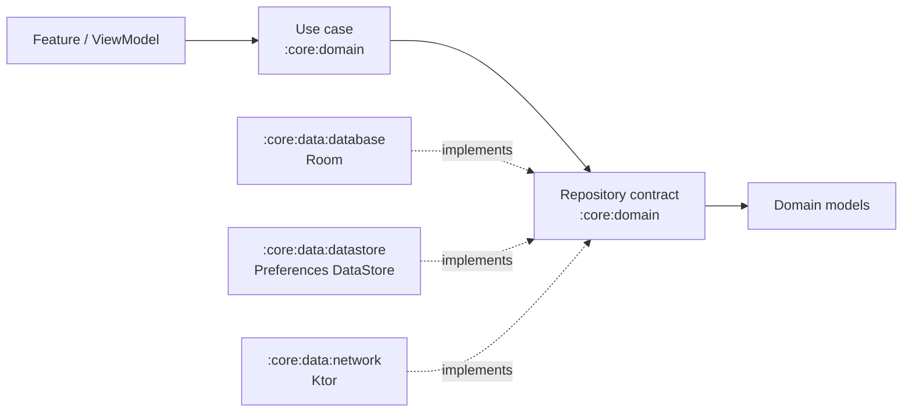

# `:core:domain` — modelos, contratos y casos de uso

Domain concentra los conceptos y operaciones que las Features necesitan sin
acoplarlas a Room, Ktor o una plataforma concreta. En este módulo viven los
modelos de negocio, los contratos de repositorio y los casos de uso compartidos.

El código actual está en `src/commonMain`; el módulo habilita Android e iOS
como targets KMP y `commonTest` para pruebas compartidas. No hay source sets
`androidMain` o `iosMain` porque Domain no contiene implementaciones que
dependan de APIs de plataforma.

## Límites del módulo



Domain declara qué operación necesita la aplicación; los módulos de datos
implementan sus contratos. Domain no importa entidades Room, DTOs de red,
Compose ni Koin. En el estado actual sí depende de `:core:tools` para tipos
compartidos como `NetworkResult` y `CodeServices`, además de coroutines para
`Flow`.

## Estructura actual

| Paquete | Contenido |
|---|---|
| `model/` | Modelos independientes de persistencia y transporte: `UserModel`, `LoginCredentialsModel`, `LoginDataModel`, `LoginModel` y `LoginTokensModel`. |
| `repository/` | Contratos que implementan los módulos de datos: `UserDataBaseRepository`, `UserDataStoreRepository` y `LoginNetworkRepository`. |
| `usecase/` | Operaciones consumibles por las Features: `UserDataBaseUseCase`, `UserDataStoreUseCase` y `LoginNetworkUseCase`. |

El grafo de módulos se define en
[`settings.gradle.kts`](../../settings.gradle.kts); las dependencias directas
de Domain están en [`build.gradle.kts`](build.gradle.kts). Actualmente el
módulo depende de coroutines y `:core:tools`, no de los módulos de Data,
Presentation ni Koin.

## Ejemplo existente: operación de base de datos

Domain declara un contrato usando `UserModel`, no `UserEntity`:

```kotlin
interface UserDataBaseRepository {
    suspend fun getFirstUser(): Flow<UserModel?>
}
```

El caso de uso delega en el contrato:

```kotlin
class UserDataBaseUseCase(
    private val repository: UserDataBaseRepository,
) {
    suspend fun getFirstUser(): Flow<UserModel?> =
        repository.getFirstUser()
}
```

`:core:data:database` implementa `UserDataBaseRepository`, consulta el DAO y
convierte la entidad mediante `UserMapper`. El caso de uso y el contrato no
conocen el DAO, Room ni la entidad. Para ver el flujo completo, consulta la
[guía de `:core:data:database`](../data/database/README.md).

## Ejemplo existente: login remoto

`LoginNetworkRepository` recibe un `LoginCredentialsModel` y devuelve
`Flow<NetworkResult<LoginDataModel>>`. `LoginNetworkUseCase` recibe los valores
de entrada, recorta email y contraseña, crea el modelo de credenciales y
delega en el contrato. El contrato y el resultado usados en este módulo son
los tipos actuales; no hay un `DomainResult` definido aquí.

`LoginNetworkRepositoryImpl` y `LoginRemoteDataSourceImpl` pertenecen a
`:core:data:network`. Las respuestas serializables y la conversión a los
modelos de Domain viven también en Network data, no en este módulo.

## Añadir una operación nueva

Mantén el mismo orden de responsabilidades. El siguiente ejemplo es una
plantilla ilustrativa, no una API que ya exista:

```kotlin
data class CatalogItem(
    val id: String,
    val title: String,
)

interface CatalogRepository {
    suspend fun getItems(): Flow<List<CatalogItem>>
}

class GetCatalogItemsUseCase(
    private val repository: CatalogRepository,
) {
    suspend operator fun invoke(): Flow<List<CatalogItem>> =
        repository.getItems()
}
```

1. Agrega modelos neutrales al almacenamiento y transporte en `model/`.
2. Define en `repository/` un contrato con esos modelos y el tipo de retorno
   que realmente necesite la operación.
3. Crea en `usecase/` una operación enfocada que delegue al contrato y aplique
   solo reglas de negocio que correspondan a Domain.
4. En el módulo de datos propietario, implementa el contrato. Allí se hacen
   las conversiones entre modelo de Domain y entidad/DTO, el acceso a la fuente
   y el manejo de detalles del framework.
5. Registra el caso de uso y sus dependencias desde el módulo de datos que
   compone esa implementación. Los módulos actuales lo hacen en sus módulos
   Koin; Domain no importa ni registra Koin.
6. Agrega pruebas en `commonTest` para las reglas de negocio y los casos de uso.
   Prueba consultas, red y persistencia en el módulo que implemente cada fuente.

Las funciones de los casos de uso existentes devuelven `Flow`; el trabajo
asociado ocurre cuando el consumidor colecciona ese flujo. Conserva las
firmas y la estrategia de errores de cada contrato al agregar operaciones.

## Convenciones

- Usa nombres y modelos del dominio, no términos propios de SQL, JSON o UI.
- Mantén interfaces de repositorio en Domain e implementaciones en el módulo
  de datos correspondiente.
- No agregues dependencias de Koin a este módulo; registra casos de uso desde
  la composición de datos existente.
- Reutiliza tipos compartidos de `:core:tools` solo cuando expresen un contrato
  transversal real. Evita filtrar tipos específicos de Ktor, Room o Compose.
- Si una regla solo pertenece a una Feature, ubícala en esa Feature en vez de
  ampliar el Domain global de Core.

Para entender cómo una Feature consume los módulos del build compuesto,
consulta la [guía principal de Core](../../README.md).
