# Core Presentation Navigation

Este módulo define el contrato compartido que permite que una Feature solicite una pantalla sin depender directamente de la implementación de otra Feature. Está escrito para quienes empiezan a trabajar en el proyecto; para cambiar destinos, revisa también la integración de Host y las Features consumidoras.

## Qué contiene

La API actual es `NavigationFeaturesRouter`, en `src/commonMain/kotlin/com/kmp/core/navigation/router/NavigationFeaturesRouter.kt`:

```kotlin
interface NavigationFeaturesRouter {
    fun getDeepLinkScreen(destination: DeepLinkDestination?): Screen =
        when (destination) {
            DeepLinkDestination.Login -> getLoginScreen()
            else -> getScreenAfterSplash()
        }
    fun getScreenAfterSplash(): Screen
    fun getSplashScreen(): Screen
    fun getWelcomeScreen(): Screen
    fun getLoginScreen(): Screen
}
```

Los cinco métodos devuelven `cafe.adriel.voyager.core.screen.Screen`. El módulo comparte este contrato en `commonMain` y expone Voyager mediante dependencias `api` en `build.gradle.kts`. El método por defecto `getDeepLinkScreen` enruta Login a `getLoginScreen()` y cualquier otro valor a `getScreenAfterSplash()`.

`:core:presentation:navigation` es intencionalmente solo una API de navegación. No tiene capas de datasource, repository, mapper o use case: no obtiene ni transforma datos, y tampoco implementa las pantallas o decide qué flavor debe mostrarse.

## Límites de responsabilidad

- **Core Navigation** mantiene el contrato común (`NavigationFeaturesRouter`), sin importar pantallas de las Features.
- **Cada Feature** es propietaria de sus propias pantallas Voyager. Por ejemplo, `LoginScreenInstance` se define en la Feature Login y `SplashScreenInstance` en Splash. Una Feature que necesita una pantalla de otra Feature la solicita al router; no importa directamente el `Screen` ajeno.
- **Host** conecta esos contratos con las pantallas disponibles y decide la selección que corresponde a la composición de la aplicación y al flavor/source set. Las implementaciones se registran por medio del `HostModule` del source set correspondiente.

Las cuatro implementaciones actuales de Host se llaman `NavigationFeaturesRouterImpl` y viven en los source sets de Android `ecuador`/`cenam` e iOS `iosEcuadorMain`/`iosCenamMain`. Actualmente asignan los métodos a `SplashScreenInstance`, `WelcomeScreenInstance` y `LoginScreenInstance` de las Features incluidas. La elección para una variante pertenece a Host aunque hoy esas asignaciones sean iguales. Una Feature compartida no debe inspeccionar el flavor para seleccionar pantallas.

`getSplashScreen()` devuelve la pantalla de entrada Splash: las cuatro implementaciones actuales de Host la mapean a `SplashScreenInstance`. Actualmente no encontramos ningún punto de llamada a `getSplashScreen()` en el código; el método solo aparece en el contrato y en esas implementaciones.

## Deep links disponibles

Además del router de pantallas, el módulo contiene un coordinador simple para
guardar y consumir un destino recibido por URL:

```mermaid
flowchart LR
    URL["hostapp://login"] --> Save["DeepLinkCoordinator.saveDeepLinkRoute"]
    Save --> Parser["DeepLinkParser"]
    Parser --> Pending["pending: StateFlow<DeepLinkDestination?>"]
    Pending --> Consume["getDeepLinkRoute()"]
    Consume --> Destination["DeepLinkDestination.Login"]
    Destination --> Router["NavigationFeaturesRouter.getDeepLinkScreen"]
    Router --> Screen["LoginScreenInstance"]
```



La implementación actual reconoce únicamente `hostapp://login`.
`saveDeepLinkRoute(url)` devuelve `false` si la URL no coincide y, si coincide,
guarda `DeepLinkDestination.Login` en `pending`. `getDeepLinkRoute()` devuelve
el destino pendiente y limpia el valor a `null`. Después,
`NavigationFeaturesRouter.getDeepLinkScreen(destination)` devuelve
`getLoginScreen()` para `DeepLinkDestination.Login`; si el destino es `null` o
no está reconocido, usa `getScreenAfterSplash()`. Ni el coordinador ni el
router navegan por sí solos: la capa que integra la entrada debe consumir el
destino y usar la pantalla devuelta para actualizar el navegador.

```kotlin
if (DeepLinkCoordinator.saveDeepLinkRoute(url)) {
    val destination = DeepLinkCoordinator.getDeepLinkRoute()
    val screen = router.getDeepLinkScreen(destination)
    // Entregar screen al navegador desde la capa de integración.
}
```

### Excepción actual (legacy): Welcome → Claro Dashboard

La regla de no importar ni navegar directamente a una pantalla de otra Feature tiene una excepción en `features/welcome/welcome/src/commonMain/kotlin/com/kmp/feature/welcome/featureUi/presentation/navigation/WelcomeNavigation.kt`: `WelcomeNavigation.kt` importa `ClaroDashboardScreenInstance` desde `com.kmp.feature.claroHome.featureUi.presentation.navigation` y lo pasa directamente a `navigator.push(...)`. Esta implementación todavía no usa el router para esa navegación.

El patrón desacoplado deseado es agregar al contrato `NavigationFeaturesRouter` un método que devuelva esa pantalla (por ejemplo, `getClaroDashboardScreen(): Screen`), implementarlo en cada Host asignándolo a la instancia provista por Claro Home y hacer que Welcome navegue usando el método del router. Hasta que se migre, trata el acoplamiento actual como legacy; no lo tomes como patrón para rutas nuevas.

### Entrada de deep links en Android e iOS

El coordinador y el router son compartidos; cada plataforma entrega la URL entrante y la navegación compartida decide cuándo consumirla. Actualmente solo se reconoce la URL de prueba `hostapp://login`.

#### Android

`androidApp/src/main/AndroidManifest.xml` registra el esquema `hostapp` y el host `login` en `MainActivity`. La Activity usa `singleTop` para recibir un enlace mientras ya está en la parte superior de la tarea:

- En un arranque en frío, `MainActivity.onPreCreate()` lee el URI del intent inicial y lo entrega a `DeepLinkCoordinator.saveDeepLinkRoute(...)` antes de que se cree el contenido Compose.
- Con la app activa, `MainActivity.onNewIntent(...)` procesa el nuevo intent y guarda la URL en el mismo coordinador.

#### iOS y puente con Shared

`iosApp/iosApp/Info.plist` registra `hostapp` como URL scheme. `iosApp/iosApp/ContentView.swift` recibe los enlaces con SwiftUI `.onOpenURL` y llama a `DeepLinkBridge.shared.handle(url:)`.

Swift llama al bridge, no directamente a `DeepLinkCoordinator`: este último pertenece a Core Navigation y no se expone aquí como API directa de `Shared`. `DeepLinkBridge` delega la URL al coordinador desde Kotlin. Hay una implementación equivalente en cada source set iOS seleccionado por flavor, de modo que ambos frameworks `Shared` exponen la misma API:

- [Puente Ecuador](../../../../../shared/src/iosEcuadorMain/kotlin/com/kmp/host/deeplink/DeepLinkBridge.kt)
- [Puente Cenam](../../../../../shared/src/iosCenamMain/kotlin/com/kmp/host/deeplink/DeepLinkBridge.kt)

El código Swift usa la instancia singleton que Kotlin/Native expone como `.shared`:

```swift
.onOpenURL { url in
    _ = DeepLinkBridge.shared.handle(url: url.absoluteString)
}
```

#### Consumo y destino

`DeepLinkCoordinator` valida la URL y guarda `DeepLinkDestination.Login` en un `StateFlow` pendiente. La misma navegación compartida cubre los dos momentos de entrega:

- **Arranque en frío:** la app conserva Splash; al terminar, `SplashNavigation` consume el destino pendiente, consulta `NavigationFeaturesRouter.getDeepLinkScreen(...)` y reemplaza Splash por Login.
- **App ya abierta:** `NavigationController` observa el `StateFlow`; cuando hay una pantalla distinta de Splash, consume el destino y reemplaza la pila por Login.
- **Sin un deep link válido:** no se consume una ruta de Login y se conserva el destino normal de inicio definido por el router del flavor.

El esquema personalizado es solo para pruebas con la app instalada; no verifica el dominio ni sustituye Android App Links o iOS Universal Links. Para esos enlaces HTTPS se necesitarán la asociación del dominio y los archivos web correspondientes. El sitio web y la asociación HTTPS no forman parte de este ejercicio.

Archivos de entrada y navegación:

- [Manifest Android](../../../../../androidApp/src/main/AndroidManifest.xml)
- [Entrada Android](../../../../../androidApp/src/main/kotlin/com/kmp/host/MainActivity.kt)
- [Info.plist iOS](../../../../../iosApp/iosApp/Info.plist)
- [Entrada SwiftUI](../../../../../iosApp/iosApp/ContentView.swift)
- [Controlador de navegación compartido](../../../../../features/splash/splash/src/commonMain/kotlin/com/kmp/feature/splash/featureUi/presentation/controller/NavigationController.kt)
- [Navegación posterior a Splash](../../../../../features/splash/splash/src/commonMain/kotlin/com/kmp/feature/splash/featureUi/presentation/navigation/SplashNavigation.kt)

## Añadir una ruta

Usa una ruta existente como patrón, sin introducir una API distinta. Por ejemplo, la firma actual de la ruta a Login es:

```kotlin
// NavigationFeaturesRouter.kt
fun getLoginScreen(): Screen
```

La Feature que posee esa pantalla proporciona una instancia que implementa Voyager `Screen`:

```kotlin
// Feature Login: LoginNavigation.kt
data object LoginScreenInstance : Screen {
    @Composable
    override fun Content() {
        // Contenido de Login
    }
}
```

Host implementa el contrato y devuelve esa instancia:

```kotlin
// NavigationFeaturesRouterImpl.kt
override fun getLoginScreen(): Screen = LoginScreenInstance
```

Para agregar otra ruta, añade al contrato un método con retorno `Screen`, crea o reutiliza la instancia Voyager en la Feature propietaria y agrega su `override` en cada implementación de `NavigationFeaturesRouter` que Host compila para sus variantes. La instancia es un objeto `Screen`, no una llamada a un composable. Los archivos de implementación del router de cada source set son la referencia para el mapeo real.

Si el destino pertenece a una Feature que aún no está incluida en esa variante, añade también su dependencia al bundle de Features correspondiente de Host: [Android](../../../../../androidApp/build.gradle.kts) y [shared/iOS](../../../../../shared/build.gradle.kts).

Las Features consumen el contrato: Splash usa `getScreenAfterSplash()` o `getWelcomeScreen()` y reemplaza la pila con `navigator.replaceAll(...)`; Welcome solicita `getLoginScreen()` y navega con `navigator.push(...)`. La selección entre rutas según flavor o composición sigue siendo responsabilidad de Host; no agregues imports directos de pantallas de otra Feature.

## Fuentes de referencia

- [`NavigationFeaturesRouter.kt`](src/commonMain/kotlin/com/kmp/core/navigation/router/NavigationFeaturesRouter.kt)
- [`build.gradle.kts`](build.gradle.kts)
- [LoginScreenInstance](../../../../../features/login/login/src/commonMain/kotlin/com/kmp/feature/login/featureUi/presentation/navigation/LoginNavigation.kt)
- [Uso del router en Splash](../../../../../features/splash/splash/src/commonMain/kotlin/com/kmp/feature/splash/featureUi/presentation/navigation/SplashNavigation.kt)
- [Uso del router en Welcome](../../../../../features/welcome/welcome/src/commonMain/kotlin/com/kmp/feature/welcome/featureUi/presentation/navigation/WelcomeNavigation.kt)
- [Implementación Android Ecuador](../../../../../androidApp/src/ecuador/kotlin/com/kmp/host/navigation/NavigationFeaturesRouterImpl.kt)
- [Implementación Android Cenam](../../../../../androidApp/src/cenam/kotlin/com/kmp/host/navigation/NavigationFeaturesRouterImpl.kt)
- [Implementación iOS Ecuador](../../../../../shared/src/iosEcuadorMain/kotlin/com/kmp/host/navigation/NavigationFeaturesRouterImpl.kt)
- [Implementación iOS Cenam](../../../../../shared/src/iosCenamMain/kotlin/com/kmp/host/navigation/NavigationFeaturesRouterImpl.kt)
- [DeepLinkCoordinator](src/commonMain/kotlin/com/kmp/core/navigation/deeplink/DeepLinkCoordinator.kt)
- [DeepLinkParser](src/commonMain/kotlin/com/kmp/core/navigation/deeplink/DeepLinkDestination.kt)
- [Guía principal de Core](../../../README.md)
